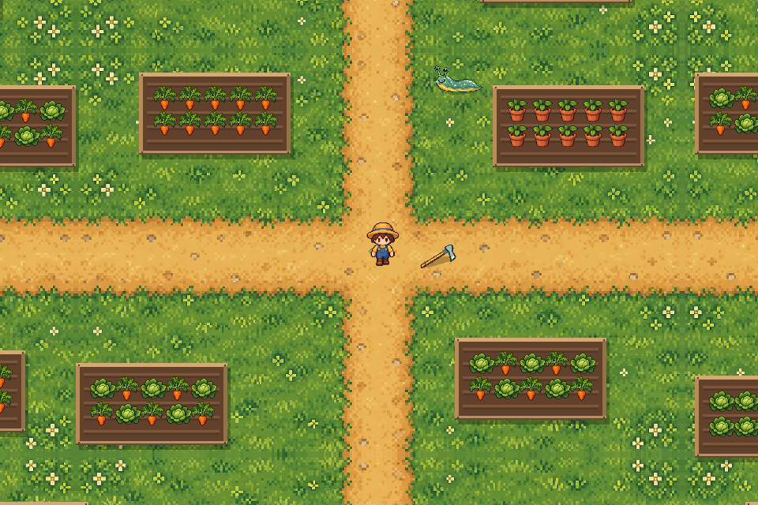

# Horta em Perigo

Jogo de sobrevivência feito na Godot 4.7. O jardineiro precisa aguentar três minutos em uma horta atacada por lesmas gigantes.

A horta de 1920 × 1280 tem 16 canteiros cercados por caminhos. O cenário é editável em camadas TileMapLayer e a câmera acompanha o jardineiro. As lesmas contornam os canteiros e chegam em grupos cada vez maiores. O jardineiro começa desarmado e equipa a enxada ao passar por ela. O tempo e os cinco pontos de vida são contados durante a partida, sem indicadores na tela. Dois golpes derrotam uma lesma.
